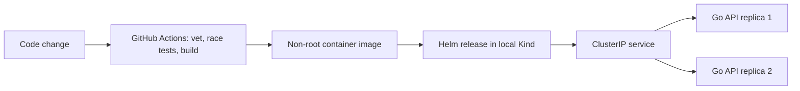

# Go Microservice Delivery with GitHub Actions and Helm

An independent, local-first portfolio project for containerizing Go microservices, validating them in CI, and delivering a reproducible Helm release to Kubernetes. It covers the Go container, build-pipeline and Kubernetes deployment exercises in the AI-driven engineering bootcamp brief. EKS provisioning, cloud registry publication and GitOps promotion are separate follow-up milestones.

## Architecture



The API exposes `GET /healthz`, `GET /readyz` and `GET /version`. It uses the Go standard library, bounded HTTP timeouts and graceful SIGTERM shutdown. The chart uses readiness/liveness probes, resource limits, a read-only root filesystem, a non-root UID, dropped capabilities and no service account token.

## Local development

Requires Go 1.26, Docker, Helm and Kind with a matching Kubernetes client.

```bash
go vet ./...
go test -race -cover ./...
helm lint chart
docker build -t go-eks-api:local .
docker run --rm -p 127.0.0.1:8080:8080 -e APP_VERSION=local go-eks-api:local
```

In another terminal, query `curl http://127.0.0.1:8080/version`. Expected JSON includes `"version":"local"`.

## Disposable Kubernetes deployment

```bash
kind create cluster --name go-lab --image kindest/node:v1.34.3 --kubeconfig ./go-lab.kubeconfig
kind load docker-image --name go-lab go-eks-api:local
helm --kubeconfig ./go-lab.kubeconfig upgrade --install go-lab chart --namespace go-lab --create-namespace --wait
kubectl --kubeconfig ./go-lab.kubeconfig -n go-lab port-forward service/go-lab-api 18082:8080
```

Query `http://127.0.0.1:18082/version`. On Apple Silicon, if multi-platform load fails, save the ARM64 image using `docker image save --platform linux/arm64 -o go-api.tar go-eks-api:local` and use `kind load image-archive --name go-lab go-api.tar` instead. Delete only the disposable cluster when finished: `kind delete cluster --name go-lab --kubeconfig ./go-lab.kubeconfig`.

CI validates formatting, race tests, container build and Helm rendering. It does not push images or deploy to EKS. Production requires approved infrastructure, image provenance, environment promotion, monitoring and rollback policies.

## Verified results — 26 November 2026

- Go 1.26.5: unit tests, race checks and `go vet` passed; 44% statement coverage (server lifecycle and signal handling are not covered by these unit tests).
- Docker: build succeeded, the version endpoint returned the supplied version, and runtime UID/GID was `10001:10001`.
- Kind Kubernetes v1.34.3: Helm chart installed successfully, two replicas Ready, and the ClusterIP service returned the expected version via local port forwarding.
- No EKS resources or registry pushes were performed.
